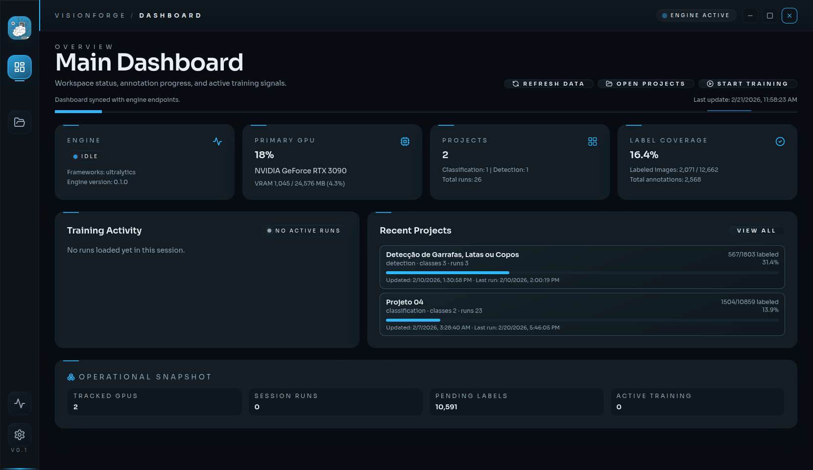
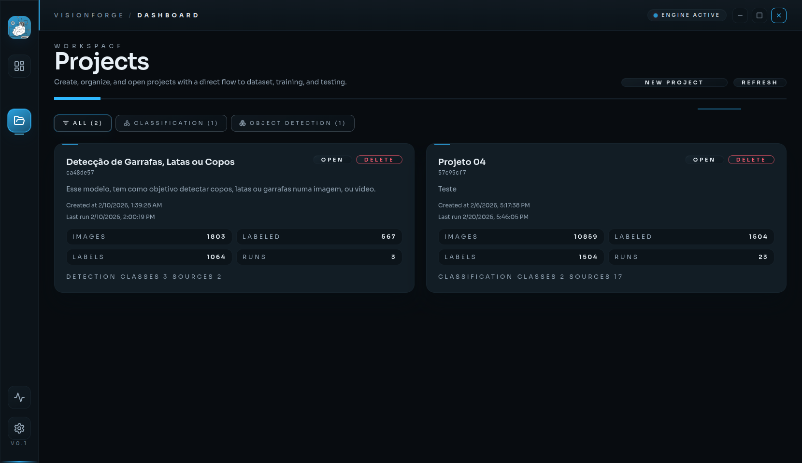
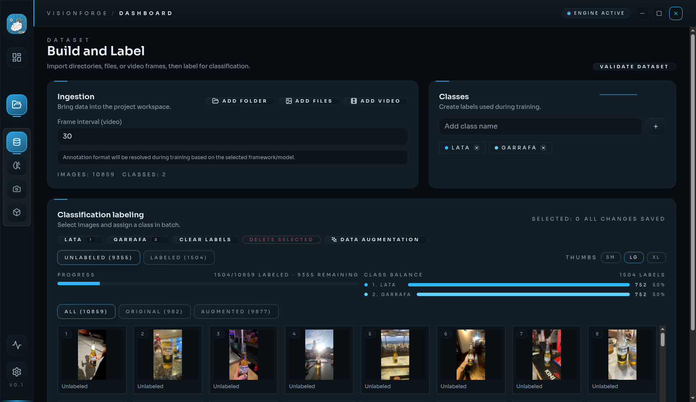
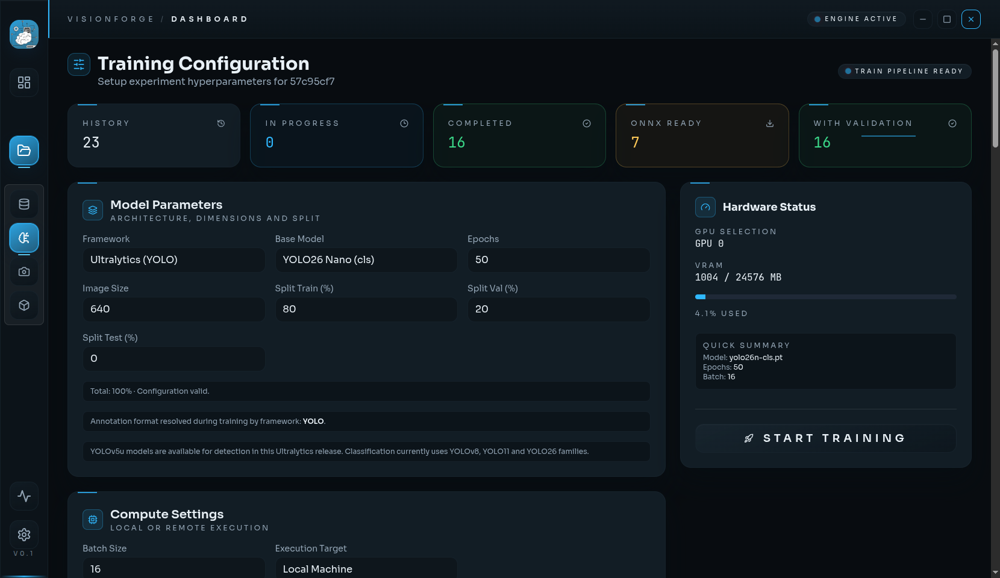
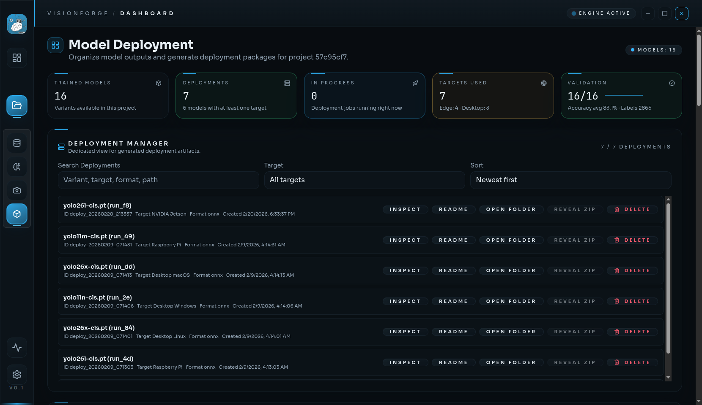

# VisionForge

VisionForge is an end-to-end desktop platform to build, train, validate, and deploy computer vision models locally.

It is designed for teams that need practical MLOps for Classification and Object Detection, with a fast UI and edge-ready deployment packages.



## Why VisionForge

- Build production-ready CV pipelines without juggling multiple tools.
- Keep your data and training workflow local-first.
- Compare models quickly and make deployment decisions with confidence.
- Generate target-specific deployment artifacts for edge and desktop environments.

## Core Capabilities

### Dataset Studio

- Import images from folders, files, and videos.
- Label data for Classification and Object Detection.
- Validate dataset integrity (corrupted files, duplicate detection, progress tracking).
- Resolve duplicates directly from the UI (ignore, keep one, remove all).
- Fast thumbnail loading for large datasets (UI optimization).

Note: thumbnails are used only for interface performance. Training always uses original images.

### Training Orchestration

- Ultralytics-based training pipeline.
- Split controls (train/val/test).
- Local runtime options (system Python, Conda, Docker).
- Live progress, metrics, and logs.

### Model Validation and Comparison

- Validate model predictions against real validation images.
- Track correctness and coverage over time.
- Highlight key metrics for decision-making (train and validation accuracy).

### Model Registry and Deployment Manager

- Centralized model cards with filters and sorting.
- Dedicated deployment manager to inspect generated packages.
- Delete generated deployments directly from the UI.
- Cancel deployment generation and clean partial artifacts safely.

### Edge-Ready Packaging

- Target-aware deployment outputs (for example: Jetson, Raspberry Pi, Desktop).
- Includes platform-specific README and run instructions.
- Bundles only validation images for post-deploy verification.

## Product Screens

### Projects



### Dataset



### Training Setup



### Models and Deployment



## Quick Start

### Prerequisites

- Node.js 18+
- Python 3.10+
- Optional: Conda
- Optional: Docker

### Install

```bash
npm install
python -m venv engine/venv
source engine/venv/bin/activate  # Windows: engine\\venv\\Scripts\\activate
pip install -r engine/requirements.txt
```

### Run (Desktop + Engine)

```bash
npm run dev
```

This starts:

- Engine API on `http://127.0.0.1:8000`
- Desktop renderer (Vite/Electron)

### Health Check

```bash
curl http://127.0.0.1:8000/health
```

Expected:

```json
{"status":"ok"}
```

## Repository Structure

- `apps/desktop`: Electron + React + TypeScript UI
- `engine`: FastAPI services, orchestration, runners
- `shared`: shared assets/schemas
- `workspace`: local data, project artifacts, logs

## Automatic Commits (Autosync)

VisionForge can auto-commit local iterations with compact commit messages.

```bash
npm run autosync:start
npm run autosync:status
npm run autosync:stop
npm run autosync:once
```

## License

Internal project. Add your preferred license before public distribution.
